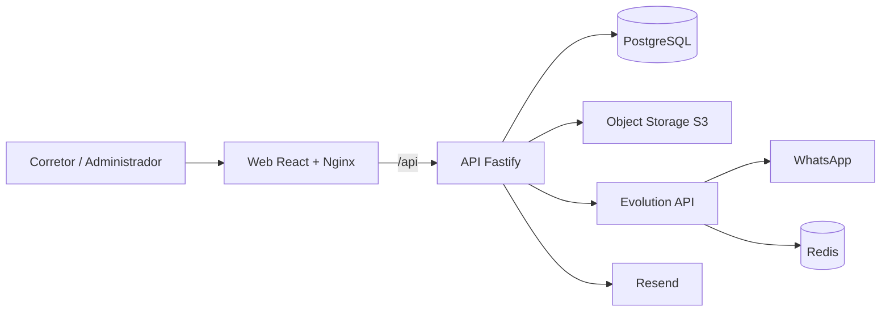

# Chavora Flow

Plataforma de assistência comercial para corretores de imóveis autônomos. O Chavora Flow reúne pipeline, conversas do WhatsApp, agenda, automações e catálogo de imóveis em uma única experiência.

[](https://www.chavoraflow.com.br)
[](https://react.dev/)
[](https://vite.dev/)
[](https://www.typescriptlang.org/)

> Status: MVP em validação privada. A criação de contas é administrada pelo operador da plataforma.

## Visão geral

O produto foi desenhado para dois perfis:

- **Corretor:** administra seus próprios leads, conversas, tarefas, imóveis e preferências.
- **Administrador da plataforma:** cria contas de corretores, acompanha o uso e controla o acesso.

Cada conta de corretor é isolada por organização no backend. O MVP não possui imobiliárias, equipes ou marketplace.

## Funcionalidades

- Dashboard com indicadores comerciais e notificações.
- Pipeline Kanban personalizável, criação de leads e histórico de atividades.
- Conversas do WhatsApp com atualização periódica, leitura, envio de texto e mídia.
- Conexão de WhatsApp por Evolution API.
- Agenda visual de tarefas com filtros de status e prioridade.
- Regras de automação e modelos de mensagem para WhatsApp.
- Catálogo de imóveis com filtros, valores formatados e até dez fotos por imóvel.
- Perfil, senha, preferências e configurações da conta.
- Recursos LGPD: consentimento, exportação, retenção, exclusão e auditoria.
- Painel administrativo separado para gestão das contas dos corretores.

## Arquitetura



Em produção, o Nginx serve a SPA e encaminha `/api/*` para a API pela rede privada do Railway. Fotos são enviadas diretamente pelo navegador ao bucket privado usando URLs pré-assinadas.

## Tecnologias

### Frontend

- React 19, React Router 7 e TypeScript 6.
- Vite 8 para desenvolvimento e build.
- Lucide React para iconografia.
- CSS modularizado por funcionalidade, sem framework visual externo.
- Vitest e ESLint para qualidade.

### Backend

- Node.js 22, Fastify 5 e TypeScript.
- Prisma 7 e PostgreSQL.
- Zod, JWT em cookie HttpOnly e bcryptjs.
- Evolution API para WhatsApp.
- Resend para e-mails transacionais.
- API S3 compatível para fotos dos imóveis.

### Infraestrutura

- Railway para web, API, PostgreSQL, Redis, Evolution API e object storage.
- Nginx para servir a SPA e fazer proxy reverso.
- Domínio oficial: [www.chavoraflow.com.br](https://www.chavoraflow.com.br).

## Estrutura do repositório

```text
src/
├── app/                 # rotas e shell da aplicação
├── components/          # componentes compartilhados de interface
├── features/            # módulos por domínio do produto
│   ├── account/
│   ├── admin/
│   ├── auth/
│   ├── automations/
│   ├── conversations/
│   ├── dashboard/
│   ├── integrations/
│   ├── leads/
│   ├── notifications/
│   ├── pipeline/
│   ├── properties/
│   └── tasks/
└── shared/              # cliente HTTP e utilitários comuns
docs/                    # documentação funcional e técnica
```

A API fica em um repositório irmão chamado `corretor-assistente-api`.

## Executando localmente

### Pré-requisitos

- Node.js 22 ou superior.
- pnpm 10.17.1, preferencialmente habilitado pelo Corepack.
- Docker Desktop para PostgreSQL, Redis e Evolution API locais.
- Repositórios web e API no mesmo diretório pai.

### 1. Frontend

```powershell
git clone https://github.com/Dev-Luis-Godoi/corretor-assistente-web.git
cd corretor-assistente-web
corepack enable
pnpm install --frozen-lockfile
Copy-Item .env.example .env
pnpm dev
```

O frontend abre por padrão em `http://localhost:5173` e usa `/api` como base da API.

### 2. Backend e serviços locais

Em outro terminal:

```powershell
cd ..\corretor-assistente-api
Copy-Item .env.example .env
docker compose up -d
corepack enable
pnpm install --frozen-lockfile
pnpm prisma:generate
pnpm prisma:deploy
pnpm dev
```

A API abre em `http://localhost:3333` e seu health check em `http://localhost:3333/health`.

O Vite encaminha as chamadas de `/api` à API local. Não coloque credenciais reais em arquivos versionados.

## Variáveis do frontend

| Variável | Padrão | Finalidade |
| --- | --- | --- |
| `VITE_API_URL` | `/api` | Prefixo usado pelo cliente HTTP. |

As variáveis e segredos do backend estão catalogados em [docs/DEVELOPMENT.md](docs/DEVELOPMENT.md). Valores reais devem permanecer no `.env` local ou no cofre de variáveis do Railway.

## Scripts

| Comando | Finalidade |
| --- | --- |
| `pnpm dev` | Inicia o Vite em modo desenvolvimento. |
| `pnpm build` | Verifica tipos e gera o build de produção. |
| `pnpm type-check` | Executa a validação TypeScript. |
| `pnpm lint` | Executa o ESLint. |
| `pnpm test` | Executa os testes com Vitest. |

Verificação recomendada antes de cada commit:

```powershell
pnpm type-check
pnpm lint
pnpm test
pnpm build
```

## Segurança e LGPD

O projeto implementa isolamento por conta, cookies HttpOnly, segredos JWT distintos para corretor e administrador, revogação por versão de sessão, CORS explícito, validação de entrada, rate limiting em rotas sensíveis, URLs pré-assinadas e registros de auditoria.

Essas medidas reduzem riscos, mas não substituem monitoramento, backups testados, rotação de segredos, política pública de privacidade nem revisão jurídica. Consulte [docs/SECURITY-AND-LGPD.md](docs/SECURITY-AND-LGPD.md).

## Documentação

- [Produto e escopo do MVP](docs/PRODUCT.md)
- [Arquitetura e integrações](docs/ARCHITECTURE.md)
- [Desenvolvimento local](docs/DEVELOPMENT.md)
- [Operação e produção](docs/OPERATIONS.md)
- [Segurança e LGPD](docs/SECURITY-AND-LGPD.md)
- [Revisão de QA e UI/UX](docs/QA-UI-UX-REVIEW.md)

## Deploy

O deploy de produção usa os `Dockerfile` dos repositórios e os health checks definidos em `railway.json`. O frontend é servido por Nginx e a API executa as migrations com o processo de release configurado no ambiente.

Consulte [docs/OPERATIONS.md](docs/OPERATIONS.md) antes de alterar domínio, banco, bucket, Evolution API ou variáveis de produção.

## Estado de qualidade

Na revisão de 13 de agosto de 2026:

- Frontend: lint, tipos, 5 testes e build aprovados.
- API: lint, tipos e build aprovados; 47 testes aprovados.
- Um arquivo central de testes da API não carregou no ambiente local por inconsistência na árvore instalada do AWS SDK. A correção recomendada é uma instalação limpa e reexecução completa antes do próximo release.
- A experiência pública de login e recuperação de senha foi verificada em desktop e mobile.
- As telas autenticadas foram auditadas por código; uma rodada E2E autenticada continua necessária.

Os riscos e recomendações priorizados estão em [docs/QA-UI-UX-REVIEW.md](docs/QA-UI-UX-REVIEW.md).

## Contribuição

O projeto está em validação privada. Mudanças devem preservar o isolamento entre contas, incluir estados de carregamento/erro/vazio, funcionar com teclado e mobile e vir acompanhadas das verificações automatizadas aplicáveis.

Não versione `.env`, tokens, senhas, chaves da Evolution API, credenciais do Resend, URLs assinadas ou credenciais do banco e do bucket.
