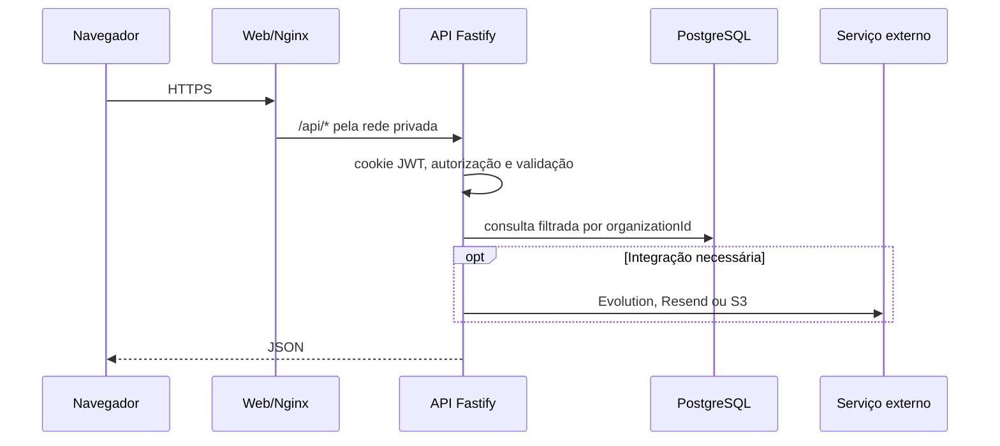

# Arquitetura

## Contexto

O sistema é composto por dois repositórios:

- `corretor-assistente-web`: SPA React, Nginx e proxy reverso.
- `corretor-assistente-api`: API Fastify, regras de negócio, Prisma e integrações.

## Frontend

### Organização

- `src/app`: rotas, proteção de acesso e layout principal.
- `src/components`: cabeçalho, navegação e elementos compartilhados.
- `src/features`: páginas, APIs, tipos e estilos agrupados por domínio.
- `src/shared`: cliente HTTP e utilitários transversais.

O roteamento separa rotas públicas, autenticadas e administrativas. O painel de plataforma usa `/admin/login` e `/admin`; corretores usam as demais rotas protegidas.

### Comunicação HTTP

O cliente em `src/shared/api/apiClient.ts`:

- usa `VITE_API_URL` ou `/api`;
- envia cookies com `credentials: include`;
- define JSON por padrão;
- converte erros da API em `ApiError`;
- direciona respostas `401` para o evento global de sessão expirada.

O cliente ainda não aplica timeout ou cancelamento padrão. O proxy de produção encerra leituras após 90 segundos.

### Atualização de dados

No MVP, atualizações próximas de tempo real usam polling:

| Recurso | Intervalo |
| --- | ---: |
| Notificações | 15 s |
| Status da conexão WhatsApp | 4 s |
| Lista de conversas | 5 s |
| Conversa aberta | 3 s |

Para escala horizontal e maior volume, SSE ou WebSocket deve substituir o polling dos fluxos de mensagens.

## Backend

### Camadas

- **Routes:** prefixos, middleware e limites de corpo/taxa.
- **Controllers:** parsing, resposta HTTP e tradução do contexto autenticado.
- **Services:** regras de negócio, transações e acesso ao Prisma.
- **Schemas:** contratos de entrada em Zod.
- **Shared/Infra:** autenticação, erros, e-mail, auditoria, banco e storage.

### Módulos

`auth`, `platform-admin`, `automations`, `contacts`, `dashboard`, `leads`, `notifications`, `organizations`, `pipelines`, `privacy`, `properties`, `tasks`, `users` e `whatsapp`.

### Dados

As entidades principais são:

- identidade: `Organization`, `User`, `PlatformAdmin`, `PasswordResetToken`;
- CRM: `Contact`, `Lead`, `PipelineStage`, `LeadActivity`, `LeadStageHistory`;
- atendimento: `WhatsappAccount`, `Conversation`, `Message`;
- produtividade: `Task`, `MessageTemplate`, `AutomationRule`, `NotificationDismissal`;
- governança: `AuditLog`, `PlatformAuditLog`;
- catálogo: `Property`, `PropertyPhoto`.

## Multi-tenancy

`Organization` é o limite de isolamento de uma conta. O `organizationId` é extraído do JWT e adicionado às consultas sensíveis pelo backend; não deve ser aceito como fonte de autoridade do frontend.

Regras obrigatórias para qualquer módulo novo:

1. Toda leitura e escrita comercial deve filtrar por `organizationId`.
2. Relações recebidas por ID devem ser confirmadas na mesma organização.
3. Chaves únicas globais devem considerar o tenant quando o domínio permitir repetição.
4. Testes devem tentar acessar e alterar dados de outra organização.
5. Logs não devem carregar conteúdo de mensagens, senha, token ou chave externa.

## Autenticação e autorização

- Corretores recebem `accessToken`; administradores recebem `adminAccessToken`.
- Os tokens usam segredos e namespaces distintos.
- Cookies são HttpOnly, `SameSite=Lax` e `Secure` em produção.
- `sessionVersion` permite revogar sessões depois de troca de senha, suspensão ou ação administrativa.
- Middlewares separam usuário autenticado, administrador da conta e administrador da plataforma.

O status `SUSPENDED` e `CANCELED` é aplicado. A data `trialEndsAt` ainda precisa ser validada no login e no middleware.

## WhatsApp e Evolution API

Cada `WhatsappAccount` pertence a uma organização e mapeia uma instância isolada da Evolution API. O webhook:

- recebe no prefixo `/webhooks/evolution/:accountId`;
- valida segredo usando comparação resistente a timing;
- limita o corpo a 256 KiB e a taxa a 300 requisições/minuto por instância da API;
- cria/atualiza contato, conversa e mensagem dentro de transação;
- usa o identificador externo da mensagem para deduplicação.

O incremento de `unreadCount` atualmente ocorre antes de saber se a mensagem já existia. Reentrega de webhook pode duplicar o contador; consulte o relatório de QA.

## Fotos de imóveis

O navegador solicita uma URL de upload com validade curta, envia a imagem diretamente ao storage e confirma o `objectKey` na API. A API valida JPEG, PNG ou WebP, tamanho máximo de 6 MiB e limite de dez fotos por imóvel. Downloads privados usam URLs assinadas.

## E-mail

O Resend envia o link de redefinição de senha. O token original vai apenas no link; o banco armazena seu hash SHA-256, com expiração e uso único. A resposta pública é neutra para evitar enumeração de e-mails.

## API por domínio

| Prefixo | Responsabilidade |
| --- | --- |
| `/auth` | login, logout, recuperação, redefinição e sessão |
| `/platform-admin` | autenticação e contas da plataforma |
| `/dashboard` | resumo operacional |
| `/contacts`, `/leads`, `/pipeline` | CRM e funil |
| `/whatsapp` | conversas, mensagens e contas Evolution |
| `/tasks`, `/automations`, `/notifications` | produtividade |
| `/properties` | catálogo e fotos |
| `/users`, `/organization` | conta e perfil |
| `/privacy` | retenção, consentimento, exportação e auditoria |
| `/webhooks/evolution` | entrada assinada da Evolution API |

Erros de negócio seguem `{ "error": "CODE", "message": "..." }`. Listagens que suportam paginação retornam `data` e `meta` com página, limite, total e total de páginas.

## Decisões e limites atuais

- Uma organização representa um corretor autônomo, mesmo que o nome técnico seja genérico.
- Não há fila de jobs; tarefas externas ocorrem no ciclo HTTP ou via webhook.
- O rate limit é mantido em memória e não é compartilhado entre réplicas.
- Redis é usado pela Evolution API, não pelo rate limiter da API principal.
- Não há contrato OpenAPI gerado; mudanças de endpoint precisam ser coordenadas entre os repositórios.
